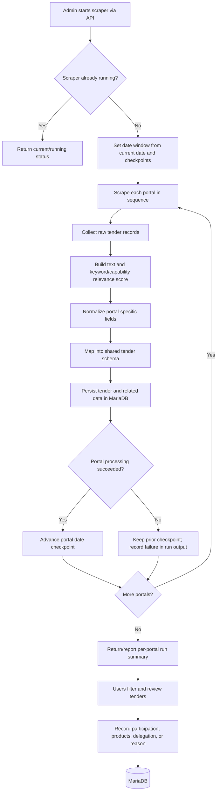

# JazzWorld B2G Tender Portal

System architecture, operational flows, data model, and security/encryption notes. This document describes the repository implementation as inspected on 29 October 2026; it is not a statement that production infrastructure has additional controls. See the [ISG documentation pack](isg/system-architecture.md) for the current source-based architecture and evidence gaps.

## 1. System at a glance

The portal is a Docker Compose application with three services. The React single-page application is built into static files and served by Nginx. Nginx serves the UI and proxies `/api/` requests to the FastAPI application. FastAPI owns login, role checks, business workflows, and tender ingestion. It accesses MariaDB through SQLAlchemy and stores scraper checkpoints in the mounted `data` directory. Local document-download and local-file retrieval routes have been retired; tender URLs and document metadata remain, and historical files may remain in storage.

```mermaid
flowchart LR
    User[Admin / Coordinator / Viewer] -->|HTTP :80| Nginx[Frontend container\nNginx + React static build]
    Nginx -->|/api/* proxy| API[Backend container\nFastAPI + SQLAlchemy]
    API -->|SQL / PyMySQL| DB[(MariaDB 10.11\nDocker volume)]
    API -->|checkpoint access; guarded historical file cleanup| Files[(Host ./data mount\ncheckpoints + retained files)]
    Scraper[In-process scraper\nFederal, Punjab, Sindh, KP, Balochistan] -->|portal HTTP(S) requests| Portals[Public procurement portals]
    API --> Scraper
    Scraper -->|persist tender records| DB
    API -->|optional alert POST| Alert[Configured alert service]
```

The scraper runs inside the backend process when an authorized API workflow starts it; it is not a separate Compose worker or scheduled service in the Compose file. A lock/status variable in `main.py` coordinates scraper execution within that backend process. Local imports for Punjab and Balochistan are also supported. Compose exposes the API on host port 8000 as well as serving it through Nginx.

## 2. Runtime components

| Component | Implementation | Responsibilities |
| --- | --- | --- |
| Web UI | React 19, React Router, Axios, Vite; Nginx image | Portal screens, login state, role-specific interaction, API calls; static build served by Nginx. |
| API | Python 3.12, FastAPI, Uvicorn, Pydantic | REST endpoints, authentication dependencies, role authorization, validation, tender workflows, scraper trigger/import, and integrations. |
| ORM and driver | SQLAlchemy 2, PyMySQL | Maps relational records to Python models and connects the backend to MariaDB. |
| Database | MariaDB 10.11 | Users, roles, regions, employees, products, tender data, relevance, documents, participation, assignment and override records. Initial SQL is mounted into the database container on first initialization. |
| Scraper | Python `requests` / `httpx`, BeautifulSoup and portal-specific modules | Reads five procurement portals, maps and normalizes records, scores keyword relevance, persists changes, and advances per-portal checkpoints. |
| File/state storage | Host `./data` mounted at `/app/data` in backend | JSON scraper state/checkpoints and any historical files retained from earlier behavior. Current source has no local document download/retrieval endpoint. |
| Optional integrations | External procurement portals, Power Automate flow, and alert consumer | Portal data and external document URLs, assignment-email payload, and pending-participation alerts. These are external integrations, not Compose services. |

### Request routing

The built frontend is delivered at `/`. The Nginx configuration serves static assets and falls back to `index.html` for client-side routes. Requests under `/api/` are reverse-proxied to `http://backend:8000`. The development Vite configuration proxies to `http://127.0.0.1:8000`.

### Backend API areas

Routes in `backend/main.py` cover:

- Authentication: `POST /api/auth/login`, `GET /api/auth/me`.
- Tender listing, details, manual entry, updates, region assignments, deletion, and overview.
- Participation status, delegation to employees, product selection, and pending-participation alerts.
- Tender document URL and metadata fields; the former local document download/retrieval API has been removed.
- Sources, regions, employees, and products for UI selection.
- Admin user and employee lifecycle management, scraper run/status/checkpoint, and scraper import.
- Assignment email/alert integration and an internal alert endpoint protected by a shared service key.

The FastAPI application is instantiated without custom docs/OpenAPI route settings, so `/docs`, `/redoc`, and `/openapi.json` are enabled by FastAPI defaults in the current source.

## 3. Main user request flow

```mermaid
sequenceDiagram
    actor U as Portal user
    participant B as Browser / React
    participant N as Nginx
    participant A as FastAPI
    participant D as MariaDB
    U->>B: Enter username and password
    B->>N: POST /api/auth/login (JSON)
    N->>A: Proxy request
    A->>D: Find user and role
    D-->>A: User record + bcrypt hash
    A->>A: Verify password; issue signed access token
    A-->>B: Bearer token + user summary
    B->>B: Store access token in localStorage
    B->>N: GET /api/auth/me with Bearer token
    N->>A: Proxy request
    A->>A: Validate token, active account, role/region dependency
    A->>D: Query authorized data
    D-->>A: Tender and related records
    A-->>B: JSON response
    B-->>U: Render role-appropriate portal view
```

Axios attaches the token from browser `localStorage` to API requests. Protected routes validate the JWT, load the user from MariaDB, check the server-side session row, reject inactive/missing accounts, and apply endpoint-specific role checks (`ADMIN`, `COORDINATOR`, `VIEWER`) and coordinator-region scoping. The token lifetime is 60 minutes; server-side idle expiry is five minutes. Logout asks the backend to revoke the session and clears browser state. The bearer token remains readable to JavaScript in local storage.

## 4. Tender ingestion and review flow



The orchestrator processes Federal PPRA, Punjab PPRA, Balochistan PPRA, KP PPRA, and Sindh PPRA independently and reports a per-source result. Each source adapter handles portal-specific pagination/API/HTML behavior. Shared processing builds tender text, finds keyword matches and suppression rules, calculates the score, normalizes portal values, maps documents and source fields, then calls persistence code to create or update records. A checkpoint is committed only after successful processing/storage and valid checkpoint metadata, allowing later runs to resume from the last completed date. The source order is sequential, not parallel.

Local Punjab/Balochistan import paths accept tender data supplied to the backend and feed records through corresponding processors. Admin users can also create tenders directly, assigning source and region and creating initial relevance and optional document metadata.

## 5. Data model overview

The SQLAlchemy models in `backend/database/models/` correspond to the relational tender workflow:

- **Identity and access:** `users` references `roles`; a coordinator can have a `coordinators` record tied to a region. Passwords are stored as hashes.
- **Reference data:** `regions`, `employees`, `products`, and `tender_sources` support assignment and filtering.
- **Tender core:** `tenders` stores source, region, public identifiers, title, organization, dates, estimated value, source/document URLs, and the source `raw_data` JSON payload.
- **Analysis and documents:** `tender_relevance` stores score, matched keywords/capabilities and reason; `tender_documents` stores document URL/metadata/status and may contain historical local paths. Local download/retrieval routes are retired; existing records/files are not removed by that code change.
- **Workflow:** `tender_participation` stores status, decision-maker, decision time, delegated employee, selected product IDs, and any non-participation reason/remarks.
- **Assignment and edits:** `tender_region_assignments` records assignment history/type; `tender_field_overrides` records user changes to scraped fields.

The SQLAlchemy relationships and foreign keys connect these records by tender `jazzid` and related IDs. JSON columns are used for source payloads and variable lists such as matched terms/product IDs.

## 6. Encryption and security mechanisms present in code

“Encryption” covers different protections. The implementation currently uses password hashing and token signing; neither encrypts all stored tender data.

| Data / boundary | Mechanism found | What it provides | Limitation in current configuration |
| --- | --- | --- | --- |
| User passwords | `bcrypt` via `bcrypt.hashpw` with `bcrypt.gensalt()`; checked with `bcrypt.checkpw` | One-way salted password hash. The original password is not recoverable from the hash. | This is hashing, not reversible encryption. Passwords in transit are protected only if the deployment is served over HTTPS. |
| API access token | PyJWT with `HS256` and `JWT_SECRET_KEY`; 60-minute `exp` | HMAC signature and integrity/authenticity. | JWT payload is encoded, not encrypted; claims can be read by whoever has the token. Keep claims non-sensitive. The backend requires a generated key of at least 32 bytes and fails startup when it is missing or unsafe. |
| Browser token storage | `localStorage` under `access_token` | Persistence across page reloads. | Not encryption. JavaScript can read it; an XSS issue could expose it. |
| Browser-to-Nginx/API transport | Compose maps frontend port 80; Nginx listens on port 80 and proxies to backend over Compose HTTP. | No TLS termination is configured in the repository deployment files. | Traffic is plaintext at this boundary unless HTTPS is terminated by infrastructure in front of the Compose stack. |
| Backend-to-MariaDB | PyMySQL URL with no TLS/SSL options configured | DB credentials authenticate the connection. | No database TLS is configured in SQLAlchemy connection settings or Compose. On the same Compose network this is an internal network hop, not encryption. |
| Database files and downloaded documents | MariaDB named volume and host-mounted `./data` | Persistence. | No application-level or volume-level encryption-at-rest setting is defined in repository configuration. Storage encryption depends on host/platform configuration. |
| Portal traffic | Scrapers use both HTTPS and HTTP source URLs. Punjab adapter pins TLS 1.2 but sets certificate verification to `CERT_NONE`. KP source is HTTP. | HTTPS can encrypt a connection when used with normal certificate verification. | Punjab's disabled certificate verification weakens server authentication; HTTP sources are unencrypted. Review per-portal behavior before relying on confidentiality/authenticity. |

The active Sindh tender-list scraper sends a Basic Authorization credential embedded in `backend/tender_scraper/scrapers/sindh.py`. The former document-downloader integration that also contained a credential was removed from current source. Treat the remaining source credential as exposed: rotate it and load it from protected configuration without committing the value. The Punjab scraper's custom TLS adapter disables certificate and hostname verification. These are open findings, not controls supplied by this documentation.

### Practical security interpretation

The concrete cryptographic controls visible in application code are **bcrypt password hashing** and **HS256 JWT signing**. There is no app-level encryption of tender fields or historical document files visible in this repository. HTTPS/TLS for users, backend-to-database TLS, and disk/volume encryption are not configured by the checked-in Compose/Nginx settings. A production deployment should supply HTTPS at a trusted edge, use strong unique secret values from a secrets manager, require TLS where database traffic crosses a trust boundary, enable storage encryption/backups appropriately, rotate/externalize the Sindh credential, and restore verified Punjab TLS.

## 7. Configuration and deployment

`docker-compose.yml` defines:

1. `backend`: builds `backend/Dockerfile`, reads root `.env`, mounts `./data:/app/data`, depends on MariaDB, and publishes port 8000.
2. `frontend`: builds `frontend/Dockerfile` (Vite build followed by Nginx static serving), depends on backend, and publishes port 80.
3. `mariadb`: MariaDB 10.11, initialized from environment variables and `database/jazzworld_b2g.sql`, with durable named volume `mariadb_data`.

`.env.example` documents expected database names/credentials, `JWT_SECRET_KEY`, `ALERT_SERVICE_KEY`, and `DATA_DIR`. It contains placeholders; put real values only in a protected deployment secret store or local ignored `.env` file, never in documentation or source control. Database initialization scripts are mounted to the MariaDB image's initialization directory and typically run when its data volume is first created.

## 8. Key code locations

- API and business workflows: `backend/main.py`
- Password hashing, token issuance and validation: `backend/auth.py`
- SQLAlchemy connection and session creation: `backend/database/connection.py`
- ORM entities: `backend/database/models/`
- Scraper coordination and persistence pipeline: `backend/tender_scraper/orchestrator_tenderfetch.py`
- Portal adapters: `backend/tender_scraper/scrapers/`
- Scoring: `backend/tender_scraper/relevance/`
- Mapping, normalization and storage: `backend/tender_scraper/storage/`
- Local document and checkpoint paths: `backend/config/paths.py`
- Frontend API token attachment: `frontend/src/api.js`
- Frontend login state: `frontend/src/auth/AuthContext.jsx`
- Nginx proxy and static routing: `frontend/nginx.conf`
- Container topology: `docker-compose.yml`

## 9. Known implementation boundaries

- Scraping is invoked by the API process, so long-running jobs share that process/container's lifecycle and resources.
- Scraper run state/locks are in memory; a process restart resets that state.
- Checkpoints and any historical document files are in `data`; database records are in the MariaDB volume, so backup/restore needs to account for both.
- Frontend CORS configuration currently allows `http://localhost:5173`; deployments with a different browser origin may need an explicit configured origin.
- Nginx and Compose provide HTTP only as checked in. HTTPS may be supplied by external infrastructure, but that is outside this repository's visible configuration.
