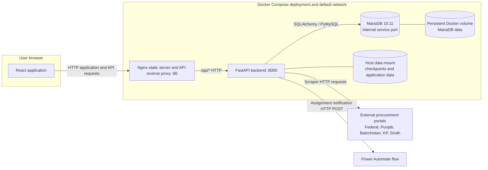

# JazzRadar / B2G Tender Management System — Architecture

## Purpose and scope

JazzRadar is an internal tender-management application. It collects procurement notices from public-sector procurement portals, stores and presents tender information, and supports administrator assignment and coordinator participation workflows. This overview describes repository configuration and source behavior; it does not assert that a production deployment exists.

## Architecture

The Docker boundary represents the local Compose configuration only. Compose publishes frontend port 80 and backend port 8000 on the host; it does not publish a MariaDB port. Nginx proxies `/api/` to the backend over HTTP. No TLS termination is configured in the repository.

## Components and technologies

| Component | Technology | Responsibility and communication |
| --- | --- | --- |
| Browser client | React, React Router, Axios | Login, protected tender views, user management, assignment and participation workflows; calls FastAPI through `/api/`. |
| Web server | Nginx | Serves the built single-page application and reverse proxies `/api/` to FastAPI. |
| API and scraper host | Python 3.12, FastAPI, Uvicorn, SQLAlchemy, PyMySQL | Authentication and authorization, tender APIs, persistence, manual/local imports, and administrator-triggered scraper orchestration. |
| Relational database | MariaDB 10.11 | User, role, coordinator, tender, assignment, participation, relevance, document metadata, and authentication-session records. |
| Scraping and mapping | Python `requests`, `curl_cffi`, BeautifulSoup and project modules | Retrieves source data, normalizes/maps it, calculates relevance, persists records, and updates portal checkpoints. |
| Persistent application data | Compose host bind mount `./data:/app/data` | Holds configured application data, including scraper checkpoint state under the configured data directory. |
| External portals | Federal PPRA, Punjab PPRA, Balochistan PPRA, KP PPRA, Sindh PPRA | Tender source systems called by portal-specific scraper code. |
| Notification integration | Power Automate | Receives assignment email payloads from the coordinator email API; configured by an environment variable whose value is not documented here. |

## Main communication paths

- Browser → Nginx → FastAPI: HTTP in the checked-in Compose/Nginx configuration.
- FastAPI → MariaDB: SQLAlchemy using the PyMySQL driver; database connection encryption is **not verified**.
- FastAPI scraper code → procurement portals: outbound HTTP client calls; endpoint-specific TLS behavior should be reviewed in scraper code and deployment runtime.
- FastAPI → Power Automate: synchronous HTTP POST with a 30-second request timeout in the assignment-email handler.
- FastAPI → persistent application storage: filesystem access for state/checkpoint files. Historical document metadata remains in the database; local document download/retrieval routes have been retired in current source.

## Deployment and assumptions

`docker-compose.yml` defines backend, frontend, and MariaDB services on the default Compose network, with a named database volume and a host-mounted backend data directory. The backend container is configured to load a root `.env` file by Compose; this document does not inspect or disclose its contents. Dockerfiles use Python, Node build tooling, and Nginx images. The backend Dockerfile does not declare a non-root user.

The repository does not establish actual production host placement, firewall rules, TLS termination, network segmentation, database encryption at rest, backup/restore controls, monitoring, or whether published ports are externally reachable. Those details require deployment evidence.
