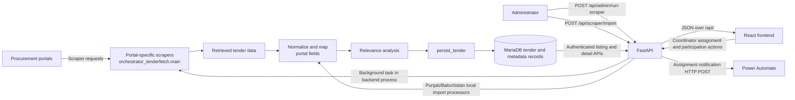

# JazzRadar / B2G Tender Management System — System Flows

These flows reflect current repository implementation. Scheduled automation outside the application is not assumed: scraper execution is started by an administrator API request and runs as a FastAPI background task in the backend process.

## Tender processing and use



The normal scraper orchestrator covers Federal PPRA, Punjab PPRA, Balochistan PPRA, KP PPRA, and Sindh PPRA. The separate local-import endpoint accepts Punjab and Balochistan payloads and is administrator-protected. Tender records retain source URLs and document metadata; local document download/retrieval routes are not part of the current flow.

## Authentication and session lifecycle

```mermaid
sequenceDiagram
  actor User
  participant UI as React AuthContext / LockScreen
  participant API as FastAPI
  participant DB as MariaDB
  User->>UI: Submit username and password
  UI->>API: POST /api/auth/login
  API->>DB: Load user and password hash
  API->>API: Verify password with bcrypt
  API->>DB: Create server-side auth session
  API-->>UI: JWT (HS256, 60-minute expiry) and user payload
  UI->>API: Protected request with bearer token
  API->>API: Validate JWT, session, active user, role/resource permissions
  API->>DB: Read session/user and protected resource
  API-->>UI: Authorized response or authentication/authorization error
  UI->>API: POST /api/auth/activity after browser interaction
  API->>DB: Conditionally update server-recorded activity time
  Note over API,DB: Idle timeout is five minutes; ordinary API calls do not refresh it
  alt User reauthenticates after idle lock
    UI->>API: POST /api/auth/reauthenticate with current bearer token and password
    API->>DB: Verify account; revoke prior session and create replacement
    API-->>UI: Replacement JWT and user payload
  else Logout
    UI->>API: POST /api/auth/logout
    API->>DB: Revoke current session
  else Session expires or is revoked
    API-->>UI: 401; protected access is rejected
  end
```

Client-side lock state is shared across tabs using browser storage/events. The server-side session check is authoritative for protected API requests; frontend locking alone does not revoke a token.
