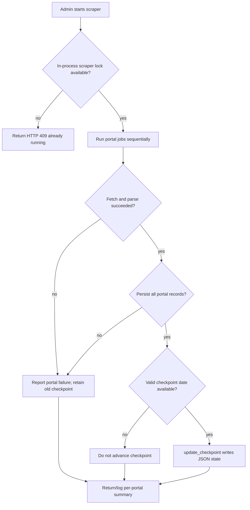

# JazzRadar / B2G TMS — System Flows

These flows reflect current source code, not a proposed deployment. Main references are `backend/main.py`, `backend/auth.py`, `backend/tender_scraper/orchestrator_tenderfetch.py`, `backend/tender_scraper/local_import_processor.py`, and `backend/tender_scraper/storage/`.

## 1. Tender ingestion

```mermaid
flowchart LR
  Admin[Administrator] -->|POST /api/admin/run-scraper| Trigger[FastAPI BackgroundTasks\nin-process task]
  Trigger --> Adapter[Portal scraper adapter\nFederal / Punjab / Balochistan / KP / Sindh]
  Portal[Procurement portal] -->|portal HTTP(S) response| Adapter
  Adapter --> Raw[Raw tender records]
  Raw --> Normalize[Normalize and score\nlocal_import_processor or orchestrator]
  Normalize --> Map[db_mapper mapping]
  Map --> Persist[persist_tender\nSQLAlchemy transaction per record]
  Persist --> DB[(MariaDB: tenders, relevance,\nregion assignment, document metadata)]
  Persist --> Result[Per-portal processing result]
  Result --> Check{Processing successful?}
  Check -->|yes| Advance[update_checkpoint\nwrite checkpoint JSON]
  Check -->|no| Preserve[Do not advance checkpoint]
```

The admin request `POST /api/admin/run-scraper` starts `run_tender_scraper()` using FastAPI `BackgroundTasks`; the API responds that the run started while the task continues in the backend process. No cron, scheduler service, or separate worker is defined in the repository. The orchestrator runs portal processing and persists mapped results using `persist_tender()`. Local import `POST /api/scraper/import` routes Punjab and Balochistan records to `process_local_punjab_tenders()` or `process_local_balochistan_tenders()`. These endpoints require an administrator session.

The scraper stores external document URLs and `TenderDocument` metadata. Local file-download routes and downloader functions were removed; ingestion does not invoke a document downloader in current source. Checkpoints are file-based under `DATA_DIR`. Per-record persistence commits inside the storage function, so a later record failure can leave earlier records committed while checkpoint advancement is withheld.

## 2. Authentication and session lifecycle

```mermaid
sequenceDiagram
  actor User
  participant Browser as React / Axios
  participant API as FastAPI
  participant DB as MariaDB

  User->>Browser: Submit username and password
  Browser->>API: POST /api/auth/login
  API->>DB: Load user and bcrypt password hash
  API->>API: verify_password; create session ID and HS256 JWT
  API->>DB: Insert auth_sessions row
  API-->>Browser: bearer token + user payload
  Browser->>Browser: Store access token in localStorage
  Browser->>API: Protected API request with bearer token
  API->>DB: Validate user, active state, session, revocation, idle age
  API-->>Browser: Protected response or 401/403
  User->>Browser: Genuine browser interaction
  Browser->>API: Throttled POST /api/auth/activity (no timestamp)
  API->>DB: Atomic conditional last_activity_at update
  Note over Browser,DB: No ordinary API call extends backend idle time
  API-->>Browser: session_idle_expired after 300 seconds idle
  Browser->>User: Lock screen requests password
  User->>Browser: Re-enter password
  Browser->>API: POST /api/auth/reauthenticate with old bearer token
  API->>DB: Verify active user/password; revoke old session; create replacement
  API-->>Browser: replacement JWT + user payload
  User->>Browser: Sign out
  Browser->>API: POST /api/auth/logout (when session still valid)
  API->>DB: Mark session revoked
  Browser->>Browser: Clear local auth state
```

JWT signing-key validation is in `backend/auth.py`; token lifetime is 60 minutes. The server-side idle threshold is 300 seconds. The React inactivity lock also uses 300 seconds and emits activity requests after tracked interactions. A frontend lock alone does not revoke a token; the backend session row is the enforcement mechanism.

Reauthentication replaces the session and invalidates the old token for later protected requests. If the JWT itself has expired, the reauthentication route cannot decode it and the user must log in again. Logout calls the server only when a token exists; the frontend clears its local state immediately. If the server call fails or the session is already idle-expired, clearing local state does not prove the server recorded a logout.

## 3. Tender use, authorization, and participation

```mermaid
sequenceDiagram
  actor Coordinator
  participant UI as React UI
  participant API as FastAPI
  participant DB as MariaDB
  participant Flow as Power Automate

  Coordinator->>UI: Open tender list or detail
  UI->>API: GET /api/tenders or GET /api/tenders/{jazzid}
  API->>DB: Validate session and query visible tender data
  Note over API,DB: Coordinator reads scoped to assigned region and positive relevance
  API-->>UI: Tender fields, including source/document URLs
  Coordinator->>UI: Update participation / delegate employee
  UI->>API: PUT participation or participation/delegate
  API->>DB: Validate coordinator region and tender relevance; persist decision
  Coordinator->>UI: Send assignment email
  UI->>API: POST /api/tenders/{jazzid}/send-assignment-email
  API->>DB: Validate assignment and region
  API->>Flow: HTTP POST assignment and tender payload
  Flow-->>API: HTTP response
  API-->>UI: Success or integration error
```

The coordinator mutation routes require `require_coordinator`; tender-specific operations check the coordinator assignment and relevance/region. The frontend route guard improves presentation but is not the authorization boundary. The API also permits admin and viewer users to read data according to their authenticated route permissions. The Power Automate integration URL is configured through `POWER_AUTOMATE_FLOW_URL`; the external flow implementation is not in this repository.

## 4. Scraper error and checkpoint recovery



`run_scraper_now()` uses a process-local lock and a background task. That state is not shared across multiple backend instances and is lost on process restart. The checkpoint implementation writes JSON state; it is separate from the MariaDB transaction. In local import processors, `persist_tender()` commits individual records; a later failure rolls back only the current uncommitted work and avoids checkpoint advancement. No durable job queue or multi-instance coordination is configured in Compose.
